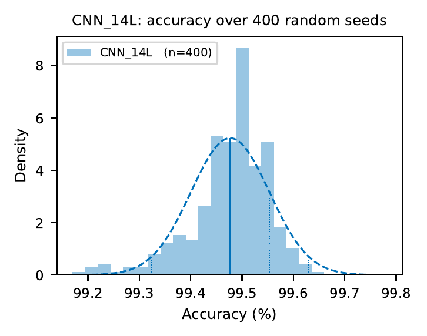

# Performance variability of neural network training on MNIST and YOLO object detection

<p align="center"><a href="https://doi.org/10.5281/zenodo.24003004"></a></p>

Train the same network twice with different random seeds and you get two different results. This repository measures
how large that variability is and what it means when you compare models.

It trains eight architectures on [MNIST](http://yann.lecun.com/exdb/mnist/) hundreds of times each, and applies the same
analyses to [YOLOv8 object detection](src/models/README.md#yolov8). From those runs it estimates the distribution of
results of each model, the probability that a given number of runs ranks two models in the wrong order, and how many
runs it takes to reach a target accuracy.

<p align="center">
  
</p>

<p align="center"><em>The 400 runs of CNN_14L on MNIST, each with a different random seed, range from 99.17% to 99.66% accuracy.</em></p>

One might expect very low variance to be a sign of overfitting, but the analyses show **no clear correlation** between
the two. Dedicated experiments (training on a reduced dataset with aggressive hyperparameters) confirm that the observed
variance patterns are not simply an artifact of overfitting.

## 📄 Article and data

The repository holds the code behind this article:

> Heredia-Aguado, E., Rujano, A., Ballesta, M., Valiente, D., & Gil, A. *The Impact of Performance
> Variability on Neural Network Evaluation and its Implications for Model Design*. Manuscript
> submitted for publication.

- **Data deposit:** the results of every trial (MNIST and YOLOv8) are archived in Zenodo at
  [doi.org/10.5281/zenodo.23977922](https://doi.org/10.5281/zenodo.23977922), public once the article is published,
  under the CC BY 4.0 license. Its README documents every field.
- **MLV Tools:** interactive browser of the results, live at
  [enheragu.github.io/mlv-tools](https://enheragu.github.io/mlv-tools)
  ([doi.org/10.5281/zenodo.20268237](https://doi.org/10.5281/zenodo.20268237)).
- **YOLOv8 fusion methods:** the object-detection part builds on
  [Static Early Fusion Techniques for Visible and Thermal Images](https://doi.org/10.3390/rs17061060)
  (*Remote Sens.* 2025, 17(6), 1060).
- **Same method elsewhere:** [cpc18-learning-playground](https://github.com/enheragu/cpc18-learning-playground) reuses
  `src/utils/` as a submodule to apply it to behavioral choice prediction.

## 🚀 Installation

```sh
git clone https://github.com/enheragu/mnist-learning-playground.git
cd mnist-learning-playground
python3 -m venv venv
source venv/bin/activate
pip install -r requirements
```

To check the setup, this downloads MNIST to `./data` and prints the number of images per class:

```sh
python src/check_dataset.py
```

Run every script from the root of the repository. The analysis runs on CPU, and training uses a GPU when there is one.
`requirements.lock` pins the exact software stack of the cross-GPU study (Python 3.11 or later; its header gives the
installation order).

## ▶️ Usage

### Regenerate the article from the data deposit

No training is needed. Put the files of the deposit in `zenodo_export/` at the root of the repository, then:

**Tables and numbers.** Each script prints its values. [`scripts/article/README.md`](scripts/article/README.md) maps
every table and figure of the article to its script, and explains the ones in R and the decision trees.

```sh
python3 scripts/article/switched_probability.py zenodo_export
python3 scripts/article/cross_machine.py zenodo_export 40000
```

**Figures and the remaining tables.** They are written to `analysis_results/`.

```sh
python src/02_compute_analysis.py
python src/03_plot_distribution.py
python src/04_check_distances.py
python src/05_check_ablation_test.py
python src/check_yolo_results.py
```

`02`, `03`, `05` and `check_yolo_results.py` select their analyses with boolean flags at the top of the file. The values
in the repository are those of the last run, so set to `True` the analyses you want; the same README says which flag
gives each figure.

Two things to keep in mind:

- **Training results take priority.** The scripts read the deposit only while `output_data/` holds no training results.
  To use it anyway, set `read_deposit = True` in `src/utils/__init__.py`, where `deposit_path` and `analysis_seed` are
  too.
- **A few items need more than the deposit.** The decision trees run the code of
  [MLV Tools](https://github.com/enheragu/mlv-tools), the sample digits come from MNIST, the table of models comes from
  the code, and the overfitting analysis reads the training logs.

### Train from scratch

```sh
python src/00_train_models.py           # Main study: each model up to 400 runs
python src/01_train_ablation_test.py    # Ablation: CNN_14L under 9 hyperparameter combinations
python src/06_train_overfit_test.py     # Overfitting experiment
```

Results go to `output_data/`. Running a script again tops up each model to its target, so a run can be interrupted and
resumed. Several processes can share the same metrics files: a run that ends once the target is reached is discarded.

- **Parallel runs:** `01_run_tmux.sh` launches 6 tmux sessions and `02_monitor_tmux.sh` shows them in a 2×3 grid. The
  launcher runs `src/00_train_models.py`, and the other training scripts are commented alternatives in `TMUX_CMD`.
- **Overfit runs:** `src/06_train_overfit_test.py` writes an empty `.exclude_from_analysis` file in its folders
  (`output_data/*_overfit_*`) to keep them out of the general analysis.

To rebuild the deposit from your own outputs, run `python src/08_export_zenodo.py`.

## 🧠 Models

| Model | What it is | Trainable parameters |
|:------|:-----------|-------------:|
| SimplePerceptron | A single fully-connected layer | 7,850 |
| HiddenLayerPerceptron | One hidden layer of 800 neurons | 636,010 |
| DNN_6L | Six fully-connected layers | 11,972,510 |
| CNN_3L | Two convolutional blocks and one linear layer | 239,006 |
| CNN_4L | CNN_3L with an extra linear layer | 528,306 |
| CNN_5L | Four convolutional layers | 534,270 |
| CNN_14L | Deep CNN with 3×3 kernels | 5,497,226 |
| BatchNormMaxoutNetInNet | Network-in-Network with maxout | 425,220 |
| YOLOv8m | Object detection, [trained in another repository](https://github.com/enheragu/yolo_test_utils) | 25,856,883 |

[`src/models/README.md`](src/models/README.md) has the diagram and the details of each one.

## 🗂️ Scripts and outputs

| Script | What it does |
|:-------|:-------------|
| `src/00_train_models.py` | Main study: 8 architectures, 400 runs each (lr 0.001, patience 10, up to 500 epochs), plus CNN_14L with batch sizes 10, 25, 50 and 80. |
| `src/01_train_ablation_test.py` | Ablation: CNN_14L with 3 batch sizes × 3 learning rates, sharing 310 seeds, with a fixed data order and up to 100 epochs. |
| `src/06_train_overfit_test.py` | Overfitting experiment: CNN_14L and DNN_6L on 2% of MNIST (lr 0.1, patience 40). |
| `src/02_compute_analysis.py` | Estimation errors, runs needed to beat a percentile, switched-order probabilities and sampling curves. |
| `src/03_plot_distribution.py` | Distribution plots, normality tests, amplitude tables and survival functions. |
| `src/04_check_distances.py` | Compares the results with the MNIST error rates published in the literature. |
| `src/05_check_ablation_test.py` | Ablation analysis: repeated-measures ANOVA, mixed models, Kendall's W, percentiles and interaction plots. |
| `src/07_check_overfit_analysis.py` | Learning curves of the overfit runs (needs the training logs). |
| `src/08_export_zenodo.py` | Builds the public deposit from a whitelist of fields, and checks it has no local paths, host names or timestamps. |
| `src/check_yolo_results.py` | The same analyses on the YOLOv8 results. |
| `src/check_model_info.py` | Mermaid diagrams and summaries of the models. |
| `src/check_dataset.py` | Number of images per class in MNIST. |
| `src/check_loss_surfaces.py` | 2D loss surfaces of trained CNN_14L models. |
| `scripts/article/` | Tables and numbers of the article that the pipeline does not produce. |
| `scripts/export_web_data.py` | Data files for MLV Tools, from the deposit. |
| `scripts/gpu_check/` | Cross-GPU replication study, with its seed pool in `seed_pools.yaml`. |

| Folder | What it holds |
|:-------|:--------------|
| `data/` | MNIST, downloaded automatically. |
| `output_data/` | Checkpoints and per-trial metrics (`randomseed_training_metrics.yaml`). |
| `analysis_results/` | Plots and tables: `model_info/`, `analysis/`, `distributions/`, `distances/`, `ablation_anova/`, `overfit_analysis/`, `yolo_analysis/` and `loss_surface/`. |
| `zenodo_export/` | The data deposit, not committed. |

## 📚 Extra documentation

- [src/models/README.md](src/models/README.md): architecture of each model.
- [scripts/article/README.md](scripts/article/README.md): which script produces each table of the article.
- [scripts/gpu_check/README.md](scripts/gpu_check/README.md): design, controls and how to run the cross-GPU study.
- [CHANGELOG.md](CHANGELOG.md): history of the project, version by version.

## 📝 How to cite

If you use this software, please cite it: the metadata are in [`CITATION.cff`](CITATION.cff), and GitHub's *Cite this
repository* button exports them as APA or BibTeX. The DOI [10.5281/zenodo.24003004](https://doi.org/10.5281/zenodo.24003004) always resolves to the
latest release; each release also has its own DOI (v1.0.1: [10.5281/zenodo.24003005](https://doi.org/10.5281/zenodo.24003005)), which is the one to cite when
reporting results obtained with that version. When reporting results, please also cite the article above.

## ⚖️ License

The code in this repository is released under the [MIT License](LICENSE).

## 🐛 Bug reports & Contact

If you find a bug or have a question, please
[open an issue](https://github.com/enheragu/mnist-learning-playground/issues) or contact the maintainer via
[email](mailto:e.heredia@umh.es).
