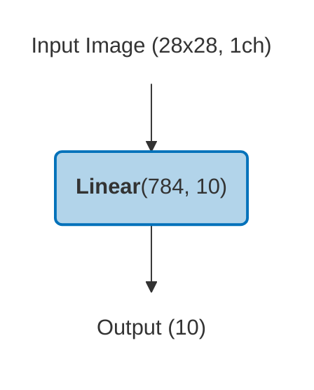
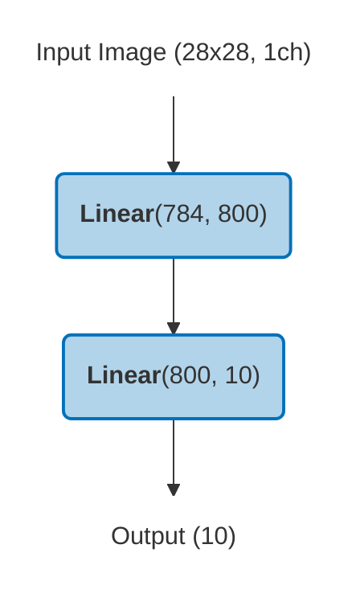
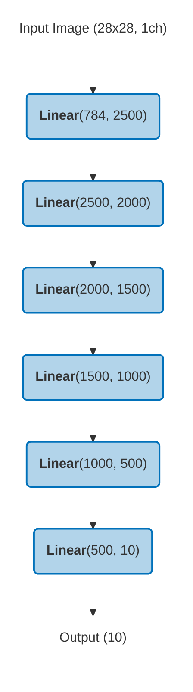
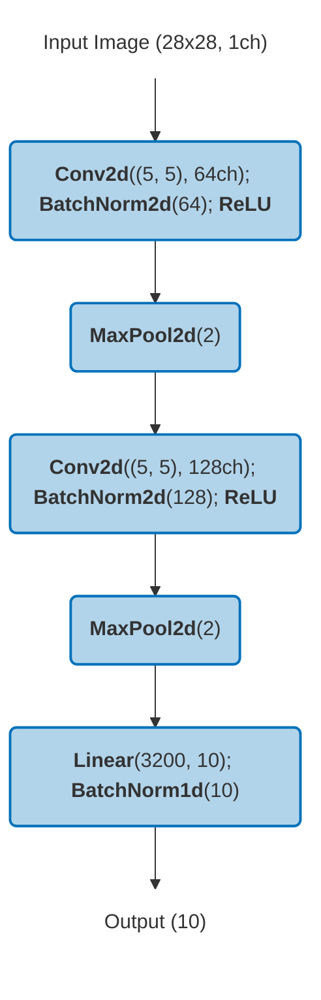
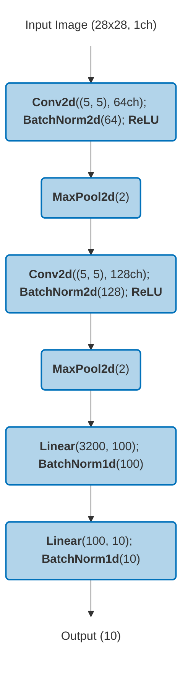
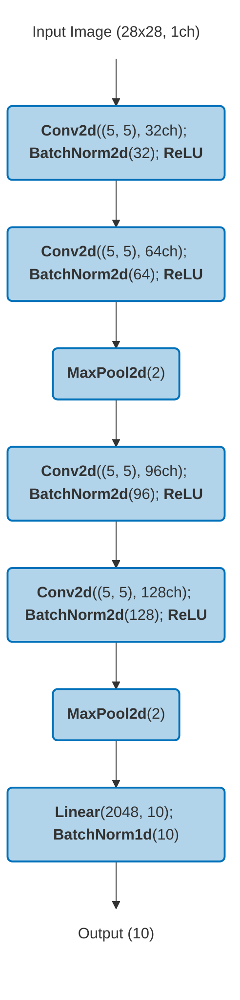

# Models

Eight MNIST architectures of increasing complexity, from a single-layer perceptron to a 14-layer CNN, plus the
YOLOv8 model of the object-detection extension. The models are representative rather than exact reproductions of
prior work. All the MNIST models inherit from `BaseModelTrainer` ([BaseModel.py](BaseModel.py)), which provides early
stopping, best-model checkpointing and per-epoch metric tracking. Early stopping and the selection of the best epoch
use the test accuracy, because MNIST has no separate validation split.

| Model | Modules | Total Params | Trainable Params | Memory (MB) |
|:------|--------:|-------------:|-----------------:|------------:|
| SimplePerceptron | 2 | 7,850 | 7,850 | 0.0 |
| HiddenLayerPerceptron | 3 | 636,010 | 636,010 | 2.4 |
| DNN_6L | 7 | 11,972,510 | 11,972,510 | 45.7 |
| CNN_3L | 14 | 239,006 | 239,006 | 0.9 |
| CNN_4L | 16 | 528,306 | 528,306 | 2.0 |
| CNN_5L | 20 | 534,270 | 534,270 | 2.0 |
| CNN_14L | 47 | 5,497,226 | 5,497,226 | 21.0 |
| BatchNormMaxoutNetInNet | 46 | 425,220 | 425,220 | 1.6 |
| YOLOv8m | 295 | 25,856,899 | 25,856,883 | 98.6 |

*Modules* counts every entry of the model summary (convolutions, BatchNorm, activations, pooling...), not the depth in
the name of the model. The MNIST rows and the diagrams come from `src/check_model_info.py`, which walks the registered
modules, so an activation applied with `torch.relu` inside `forward` does not appear in a diagram.

## SimplePerceptron

A single fully-connected layer: the simplest possible baseline.

*Check model implementation in [SimplePerceptron.py](SimplePerceptron.py).*

## HiddenLayerPerceptron

One hidden layer with 800 neurons, followed by a ReLU that `forward` applies (not shown in the diagram).

*Check model implementation in [HiddenLayerPerceptron.py](HiddenLayerPerceptron.py).*

## DNN_6L

A 6-layer deep neural network with decreasing layer sizes (2500 → 10), with a ReLU after each hidden layer that `forward` applies (not shown in the diagram).

*Check model implementation in [DNN_6L.py](DNN_6L.py).*

## CNN_3L

A compact CNN with 2 conv blocks (5×5 kernels, BatchNorm, ReLU, MaxPool) and one FC layer.

*Check model implementation in [CNN_3L.py](CNN_3L.py).*

## CNN_4L

Similar to CNN_3L but adds an extra FC layer (100 neurons). There is no activation between its two linear layers, only BatchNorm.

*Check model implementation in [CNN_4L.py](CNN_4L.py).*

## CNN_5L

A deeper CNN with 4 conv layers (5×5 kernels, increasing channels 32→128) and 2 MaxPool stages.

*Check model implementation in [CNN_5L.py](CNN_5L.py).*

## CNN_14L

A large 14-layer CNN with 3×3 kernels, groups of repeated conv blocks (indicated by **×N**), a 1×1 bottleneck expansion to 2048 channels, and a single FC output.

*Check model implementation in [CNN_14L.py](CNN_14L.py).*

```mermaid
flowchart TD
    input_image("Input Image (28x28, 1ch)"):::noBox
    Conv2d_0_Sequential_conv_layers("<b>Conv2d</b>((3, 3), 64ch); <b>BatchNorm2d</b>(64); <b>ReLU</b>"):::blockStyle
    Conv2d_3_Sequential_conv_layers("<b>Conv2d</b>((3, 3), 128ch); <b>BatchNorm2d</b>(128); <b>ReLU</b>"):::blockStyle
    MaxPool2d_6_Sequential_conv_layers("<b>MaxPool2d</b>(2)"):::blockStyle
    subgraph subgraph_4 [" "]
        subgraph_4_count("<b>x4</b>"):::noBox
        subgraph_4_block("<b>Conv2d</b>((3, 3), 128ch); <b>BatchNorm2d</b>(128); <b>ReLU</b>"):::blockStyle
    end
    style subgraph_4 fill:#a664974D,stroke:#a66497,stroke-width:2px,rx:10px,ry:10px
    Conv2d_19_Sequential_conv_layers("<b>Conv2d</b>((3, 3), 256ch); <b>BatchNorm2d</b>(256); <b>ReLU</b>"):::blockStyle
    MaxPool2d_22_Sequential_conv_layers("<b>MaxPool2d</b>(2)"):::blockStyle
    subgraph subgraph_10 [" "]
        subgraph_10_count("<b>x2</b>"):::noBox
        subgraph_10_block("<b>Conv2d</b>((3, 3), 256ch); <b>BatchNorm2d</b>(256); <b>ReLU</b>"):::blockStyle
    end
    style subgraph_10 fill:#a664974D,stroke:#a66497,stroke-width:2px,rx:10px,ry:10px
    Conv2d_29_Sequential_conv_layers("<b>Conv2d</b>((3, 3), 512ch); <b>BatchNorm2d</b>(512); <b>ReLU</b>"):::blockStyle
    Conv2d_32_Sequential_conv_layers("<b>Conv2d</b>((1, 1), 2048ch); <b>BatchNorm2d</b>(2048); <b>ReLU</b>"):::blockStyle
    Conv2d_35_Sequential_conv_layers("<b>Conv2d</b>((1, 1), 256ch); <b>BatchNorm2d</b>(256); <b>ReLU</b>"):::blockStyle
    MaxPool2d_38_Sequential_conv_layers("<b>MaxPool2d</b>(2)"):::blockStyle
    Conv2d_39_Sequential_conv_layers("<b>Conv2d</b>((3, 3), 256ch); <b>BatchNorm2d</b>(256); <b>ReLU</b>"):::blockStyle
    Linear_0_Sequential_fc_layers("<b>Linear</b>(256, 10)"):::blockStyle
    output("Output (10)"):::noBox

    classDef blockStyle fill:#0171ba4D,stroke:#0171ba,stroke-width:2px
    classDef noBox fill:none,stroke:none;

    input_image --> Conv2d_0_Sequential_conv_layers
    Conv2d_0_Sequential_conv_layers --> Conv2d_3_Sequential_conv_layers
    Conv2d_3_Sequential_conv_layers --> MaxPool2d_6_Sequential_conv_layers
    MaxPool2d_6_Sequential_conv_layers --> subgraph_4
    subgraph_4 --> Conv2d_19_Sequential_conv_layers
    Conv2d_19_Sequential_conv_layers --> MaxPool2d_22_Sequential_conv_layers
    MaxPool2d_22_Sequential_conv_layers --> subgraph_10
    subgraph_10 --> Conv2d_29_Sequential_conv_layers
    Conv2d_29_Sequential_conv_layers --> Conv2d_32_Sequential_conv_layers
    Conv2d_32_Sequential_conv_layers --> Conv2d_35_Sequential_conv_layers
    Conv2d_35_Sequential_conv_layers --> MaxPool2d_38_Sequential_conv_layers
    MaxPool2d_38_Sequential_conv_layers --> Conv2d_39_Sequential_conv_layers
    Conv2d_39_Sequential_conv_layers --> Linear_0_Sequential_fc_layers
    Linear_0_Sequential_fc_layers --> output
```

Click to expand architecture diagram

## BatchNormMaxoutNetInNet

A Network-in-Network architecture with 3 MINBlocks, each containing Conv → 1×1 Conv → MaxOut → 1×1 Conv → MaxOut → AvgPool → Dropout.

*Check model implementation in [BatchNormMaxoutNetInNet.py](BatchNormMaxoutNetInNet.py).*

```mermaid
flowchart TD
    input_image("Input Image (28x28, 1ch)"):::noBox
    Conv2d_conv_MINBlock_block1("<b>Conv2d</b>((5, 5), 128ch); <b>BatchNorm2d</b>(128)"):::blockStyle
    Conv2d_0_Sequential_mlp1_MINBlock_block1("<b>Conv2d</b>((1, 1), 96ch)"):::blockStyle
    MaxOutLayer_1_Sequential_mlp1_MINBlock_block1("<b>MaxOutLayer</b>(96, 96; k=5); <b>BatchNorm2d</b>(96)"):::blockStyle
    Conv2d_0_Sequential_mlp2_MINBlock_block1("<b>Conv2d</b>((1, 1), 48ch)"):::blockStyle
    MaxOutLayer_1_Sequential_mlp2_MINBlock_block1("<b>MaxOutLayer</b>(48, 48; k=5); <b>BatchNorm2d</b>(48)"):::blockStyle
    AvgPool2d_pool_MINBlock_block1("<b>AvgPool2d</b>(3; s:2, p=0)"):::blockStyle
    Dropout_dropout_MINBlock_block1("<b>Dropout</b>(0.5)"):::blockStyle
    Conv2d_conv_MINBlock_block2("<b>Conv2d</b>((5, 5), 128ch); <b>BatchNorm2d</b>(128)"):::blockStyle
    Conv2d_0_Sequential_mlp1_MINBlock_block2("<b>Conv2d</b>((1, 1), 96ch)"):::blockStyle
    MaxOutLayer_1_Sequential_mlp1_MINBlock_block2("<b>MaxOutLayer</b>(96, 96; k=5); <b>BatchNorm2d</b>(96)"):::blockStyle
    Conv2d_0_Sequential_mlp2_MINBlock_block2("<b>Conv2d</b>((1, 1), 48ch)"):::blockStyle
    MaxOutLayer_1_Sequential_mlp2_MINBlock_block2("<b>MaxOutLayer</b>(48, 48; k=5); <b>BatchNorm2d</b>(48)"):::blockStyle
    AvgPool2d_pool_MINBlock_block2("<b>AvgPool2d</b>(3; s:2, p=0)"):::blockStyle
    Dropout_dropout_MINBlock_block2("<b>Dropout</b>(0.5)"):::blockStyle
    Conv2d_conv_MINBlock_block3("<b>Conv2d</b>((3, 3), 128ch); <b>BatchNorm2d</b>(128)"):::blockStyle
    Conv2d_0_Sequential_mlp1_MINBlock_block3("<b>Conv2d</b>((1, 1), 96ch)"):::blockStyle
    MaxOutLayer_1_Sequential_mlp1_MINBlock_block3("<b>MaxOutLayer</b>(96, 96; k=5); <b>BatchNorm2d</b>(96)"):::blockStyle
    Conv2d_0_Sequential_mlp2_MINBlock_block3("<b>Conv2d</b>((1, 1), 10ch)"):::blockStyle
    MaxOutLayer_1_Sequential_mlp2_MINBlock_block3("<b>MaxOutLayer</b>(10, 10; k=5); <b>BatchNorm2d</b>(10)"):::blockStyle
    AvgPool2d_pool_MINBlock_block3("<b>AvgPool2d</b>(1; s:1, p=0)"):::blockStyle
    Dropout_dropout_MINBlock_block3("<b>Dropout</b>(0.0)"):::blockStyle
    output("Output (10)"):::noBox

    classDef blockStyle fill:#0171ba4D,stroke:#0171ba,stroke-width:2px
    classDef noBox fill:none,stroke:none;

    input_image --> Conv2d_conv_MINBlock_block1
    Conv2d_conv_MINBlock_block1 --> Conv2d_0_Sequential_mlp1_MINBlock_block1
    Conv2d_0_Sequential_mlp1_MINBlock_block1 --> MaxOutLayer_1_Sequential_mlp1_MINBlock_block1
    MaxOutLayer_1_Sequential_mlp1_MINBlock_block1 --> Conv2d_0_Sequential_mlp2_MINBlock_block1
    Conv2d_0_Sequential_mlp2_MINBlock_block1 --> MaxOutLayer_1_Sequential_mlp2_MINBlock_block1
    MaxOutLayer_1_Sequential_mlp2_MINBlock_block1 --> AvgPool2d_pool_MINBlock_block1
    AvgPool2d_pool_MINBlock_block1 --> Dropout_dropout_MINBlock_block1
    Dropout_dropout_MINBlock_block1 --> Conv2d_conv_MINBlock_block2
    Conv2d_conv_MINBlock_block2 --> Conv2d_0_Sequential_mlp1_MINBlock_block2
    Conv2d_0_Sequential_mlp1_MINBlock_block2 --> MaxOutLayer_1_Sequential_mlp1_MINBlock_block2
    MaxOutLayer_1_Sequential_mlp1_MINBlock_block2 --> Conv2d_0_Sequential_mlp2_MINBlock_block2
    Conv2d_0_Sequential_mlp2_MINBlock_block2 --> MaxOutLayer_1_Sequential_mlp2_MINBlock_block2
    MaxOutLayer_1_Sequential_mlp2_MINBlock_block2 --> AvgPool2d_pool_MINBlock_block2
    AvgPool2d_pool_MINBlock_block2 --> Dropout_dropout_MINBlock_block2
    Dropout_dropout_MINBlock_block2 --> Conv2d_conv_MINBlock_block3
    Conv2d_conv_MINBlock_block3 --> Conv2d_0_Sequential_mlp1_MINBlock_block3
    Conv2d_0_Sequential_mlp1_MINBlock_block3 --> MaxOutLayer_1_Sequential_mlp1_MINBlock_block3
    MaxOutLayer_1_Sequential_mlp1_MINBlock_block3 --> Conv2d_0_Sequential_mlp2_MINBlock_block3
    Conv2d_0_Sequential_mlp2_MINBlock_block3 --> MaxOutLayer_1_Sequential_mlp2_MINBlock_block3
    MaxOutLayer_1_Sequential_mlp2_MINBlock_block3 --> AvgPool2d_pool_MINBlock_block3
    AvgPool2d_pool_MINBlock_block3 --> Dropout_dropout_MINBlock_block3
    Dropout_dropout_MINBlock_block3 --> output
```

Click to expand architecture diagram

## YOLOv8

As an extension of the study to a more complex domain, **YOLOv8m** (medium variant, 3-channel input) is also trained for object detection on [COCO](https://cocodataset.org/) and on the KAIST and LLVIP multispectral (visible and thermal) datasets. On the multispectral datasets, multiple static image fusion methods are explored to evaluate their impact on detection variance. Training and management of YOLO experiments is handled through a separate repository: [yolo_test_utils](https://github.com/enheragu/yolo_test_utils).

The analysis scripts in this repo (`src/check_yolo_results.py`) consume the YOLO training outputs to perform the same statistical analyses (switched probability, survival functions, distribution plots, ablation tests) applied to the MNIST models.

## Implementation notes

These details stay as they are, because changing them would stop matching the published runs and the training
fingerprint of the cross-GPU study:

- **BatchNormMaxoutNetInNet** has no final linear layer, so it outputs 250 values instead of 10. It trains because the
  MNIST labels are below 250.
- **CNN_14L** uses `BatchNorm2d(momentum=0.95)`. PyTorch applies that weight to the current batch, the opposite of the
  Caffe convention, where it would keep the running average.
- **`best_epoch`** assumes that a run stopped through patience, so it can be wrong in a run that reaches the epoch cap.
  This only happens in the overfitting experiment (12 of the 400 runs of `CNN_14L_overfit_0.02`).
- **`total_epochs`** is one less than the number of epochs that were run.
- **`CNN_4L.py`** names the C1 architecture in a comment, while the model is inspired by C2.
